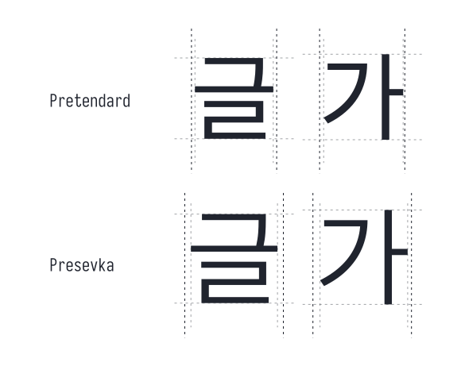

# Presevka

<p align="center">
  <picture>
    <source media="(prefers-color-scheme: dark)" srcset="./assets/presevka-banner-dark.svg">
    <source media="(prefers-color-scheme: light)" srcset="./assets/presevka-banner-light.svg">
    
  </picture>
</p>

---

<p align="center">
<span style="font-style: italic;">
  Iosevka에 Pretendard의 한글을 결합한 고정폭 글꼴<br>
</span>
</p>


[Presevka](https://github.com/xkho/presevka)는 Iosevka 또는 Pretendard의 공식 배포판이 아니며, [Iosevka](https://github.com/be5invis/Iosevka)를 코드와 라틴 문자의 기반으로, [Pretendard](https://github.com/orioncactus/pretendard)를 한글 글리프의 기반으로 삼는 독립적인 폰트입니다. 한글 글리프가 포함된 Iosevka 스타일 폰트를 찾는다면, [Sarasa Gothic](https://github.com/be5invis/Sarasa-Gothic)도 찾아보세요!

## 다운로드

1. [Github release 에서 다운받기](https://github.com/xkho/presevka/releases/latest)
2. [Source 에서 빌드하는 방법 보기](./docs/build_from_source_instruction.md)

## 특징

현대 한글 음절 11,172자 전체와 호환 자모 53자를 담았습니다. 힌팅이 적용되어 11–13px처럼 작은 크기에서 한글 가로획이 픽셀 그리드에 맞아 또렷하며, Pretendard 한글 윤곽은 원본 비율을 유지한 채 가로로 2%만 확대하고, 나머지 폭은 좌우 여백으로 둡니다. 가독성을 위해 한글 글리프는 Italic이 적용되지 않습니다.

<p align="center">
  <picture>
    <source media="(prefers-color-scheme: dark)" srcset="./assets/presevka-specimen-dark.svg">
    <source media="(prefers-color-scheme: light)" srcset="./assets/presevka-specimen-light.svg">
    
  </picture>
</p>


--- 

## Pretendard는 이렇게 얹었습니다

<p align="center">
  <picture>
    <source media="(prefers-color-scheme: dark)" srcset="./assets/presevka-cells-dark.svg">
    <source media="(prefers-color-scheme: light)" srcset="./assets/presevka-cells-light.svg">
    
  </picture>
</p>

Pretendard는 한글을 0.864 em 폭에 담습니다. Presevka는 그 칸을 1 em으로 넓혀
라틴 두 칸과 정확히 맞물리게 했습니다.

칸은 15.7% 넓어졌지만 글자는 가로로 2%만 키웠습니다. 칸을 채우려 늘린 것이
아니라, 라틴 옆에서 너무 가늘어 보이지 않을 만큼의 광학 보정입니다. 세로는
건드리지 않았고, 남는 폭은 좌우 여백이 됩니다. 아홉 굵기 모두에 같은 2%를
적용해 Pretendard가 굵기별로 잡아 둔 가로 비례를 흐트러뜨리지 않았습니다.

위 그림에서 진한 세로선이 글자가 차지하는 칸, 흐린 선이 글자가 실제로 그려지는
범위입니다. 두 줄을 견주어 보면 흐린 선은 거의 제자리인데 진한 선만 벌어집니다.

그 밖에 윤곽을 CFF에서 TrueType으로 옮기고, 원본의 2048 유닛 em을 Iosevka와
같은 1000 유닛으로 맞췄습니다. 자세한 내용은 [FONTLOG.md](./FONTLOG.md)에
있습니다.

## Iosevka features

Presevka의 라틴 글자는 [Iosevka](https://github.com/be5invis/Iosevka)를 손대지
않고 그대로 씁니다. 그래서 Iosevka의 stylistic set 19종과 character variant
99종이 폰트 안에 함께 들어 있고, 다시 받거나 빌드하지 않아도 에디터 설정만으로
켜집니다.

```jsonc
"editor.fontLigatures": "'ss14'"
```

고를 수 있는 목록과 Adwaita Mono 스타일을 포함한 사용법은
[Iosevka features](./docs/iosevka_features.md)에 있습니다.

## 라이선스

- 완성 폰트와 폰트 수정물: [SIL Open Font License 1.1](./LICENSE)
- Presevka의 Python/shell 빌더: [MIT](./LICENSE-CODE)
- 원본 저작권·Reserved Font Name: [OFL.txt](./OFL.txt)
- 원본 출처: [THIRD_PARTY.md](./THIRD_PARTY.md)
- 변경 이력: [FONTLOG.md](./FONTLOG.md)

## 크레딧

- [Iosevka](https://github.com/be5invis/Iosevka) — Renzhi Li / The Iosevka Project Authors
- [Pretendard](https://github.com/orioncactus/pretendard) — Kil Hyung-jin and upstream authors
