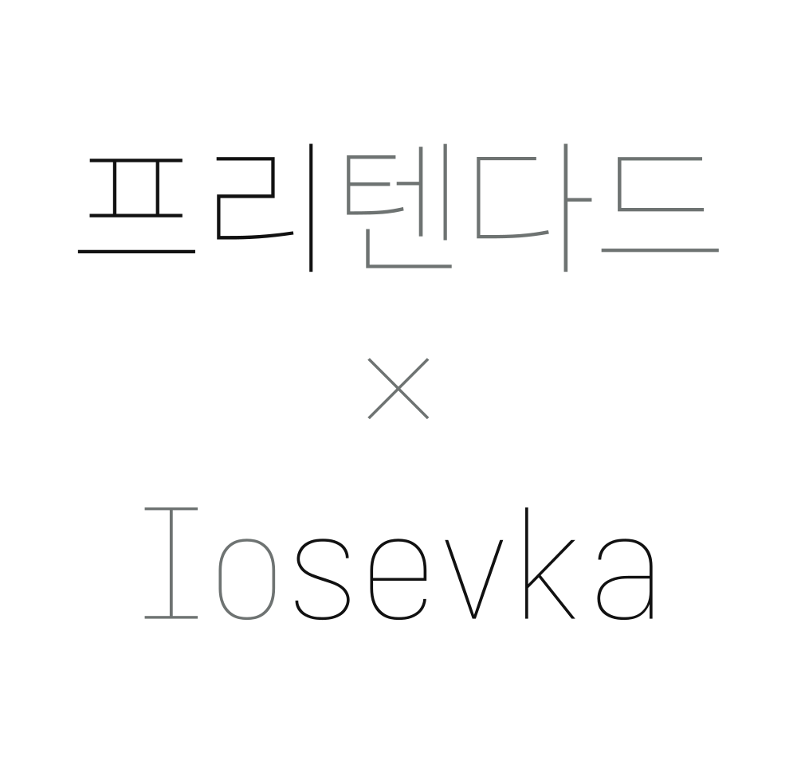
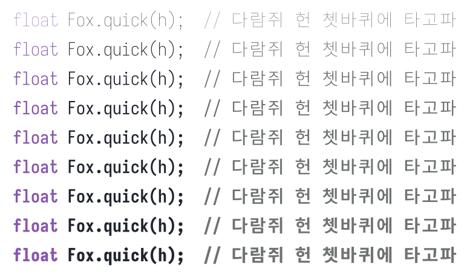

<p align="center">
  <picture>
    <source media="(prefers-color-scheme: dark)" srcset="./assets/presevka-banner-dark.svg">
    <source media="(prefers-color-scheme: light)" srcset="./assets/presevka-banner-light.svg">
    
  </picture>
</p>

---

<p align="center">
<span style="font-style: italic;">
  Iosevka에 Pretendard의 한글을 결합한 고정폭 글꼴<br>
</span>
</p>


[Presevka](https://github.com/xkho/presevka)는 Iosevka 또는 Pretendard의 공식 배포판이 아니며, [Iosevka](https://github.com/be5invis/Iosevka)를 코드와 라틴 문자의 기반으로, [Pretendard](https://github.com/orioncactus/pretendard)를 한글 글리프의 기반으로 삼는 독립적인 폰트입니다. 한글 글리프가 포함된 Iosevka 스타일 폰트를 찾는다면, [Sarasa Gothic](https://github.com/be5invis/Sarasa-Gothic)도 찾아보세요!

## 다운로드

1. [Github release 에서 다운받기](https://github.com/xkho/presevka/releases/latest)
2. [Source 에서 빌드하는 방법 보기](./docs/build_from_source_instruction.md)

## 특징

[Pretendard](https://github.com/orioncactus/pretendard)에서 제공하는 현대 한글 음절 11,172자 전체와 호환 자모 53자를 담았으며, 힌팅이 적용되어 11–13px처럼 작은 크기에서도 그 가독성을 유지합니다. 
*(Pretendard의 강점인 가독성을 위해 한글 글리프는 Italic이 적용되지 않습니다.)*

<p align="center">
  <picture>
    <source media="(prefers-color-scheme: dark)" srcset="./assets/presevka-specimen-dark.svg">
    <source media="(prefers-color-scheme: light)" srcset="./assets/presevka-specimen-light.svg">
    
  </picture>
</p>


## Iosevka Customization

Presevka의 라틴 글자는 [Iosevka](https://github.com/be5invis/Iosevka)의 변형으로, Iosevka의 커스터마이징 로직을 그대로 사용합니다. 그래서 Iosevka의 stylistic set 19종과 character variant 99종이 폰트 안에 함께 들어 있어 에디터 설정만으로 사용해볼 수 있습니다. 예를 들어 Visual Studio Code 에서는 아래와 같습니다. 
자세한 Iosevka 사용자화 방법은 아래 연결된 문서에서 확인해 보세요!

```jsonc
"editor.fontLigatures": "'ss14'" // Jetbrains Mono Style
```

<table>
  <tr>
    <td>
      <h4>
        <a href="./docs/iosevka_features.md"> 
        Read More about Iosevka Customization 
        </a>
      </h4>
    </td>
  </tr>
</table>

## 라이선스

- 완성 폰트와 폰트 수정물: [SIL Open Font License 1.1](./LICENSE)
- Presevka의 Python/shell 빌더: [MIT](./LICENSE-CODE)
- 원본 저작권·Reserved Font Name: [OFL.txt](./OFL.txt)
- 원본 출처: [THIRD_PARTY.md](./THIRD_PARTY.md)
- 변경 이력: [FONTLOG.md](./FONTLOG.md)

## 크레딧

- [Iosevka](https://github.com/be5invis/Iosevka) — Renzhi Li / The Iosevka Project Authors
- [Pretendard](https://github.com/orioncactus/pretendard) — Kil Hyung-jin and upstream authors
